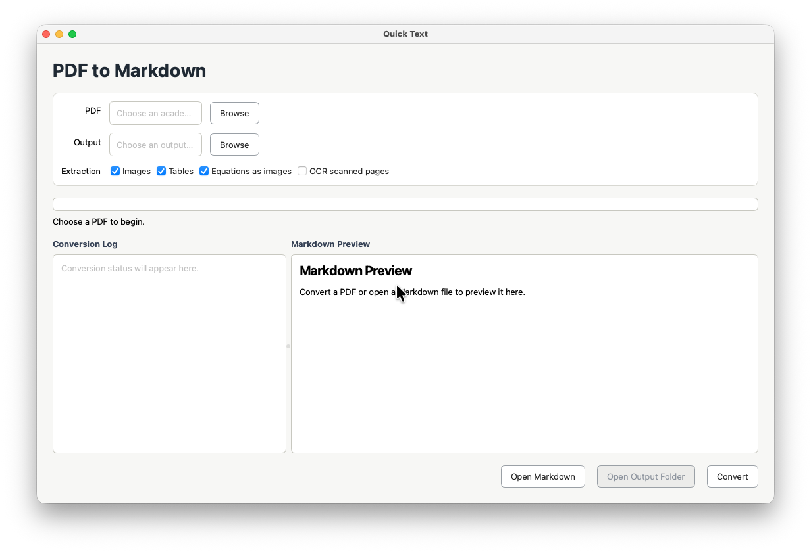
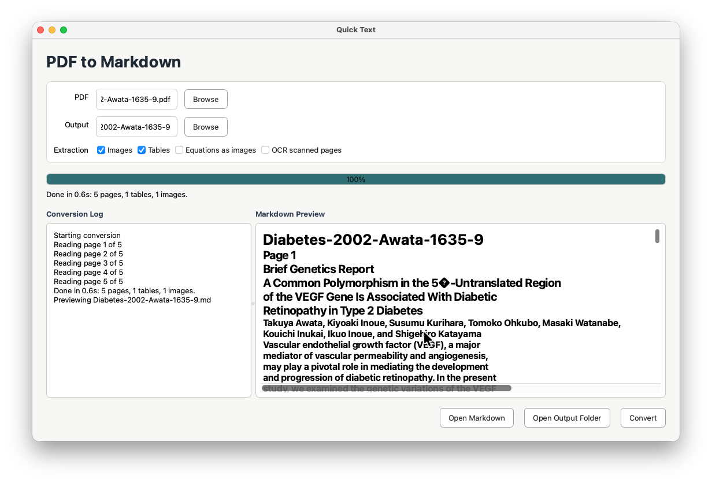

# Paper Markdown Extractor

[](https://github.com/cema-sait/quick-text/actions/workflows/tests.yml)

A small Qt desktop GUI for converting academic PDFs into clean Markdown. It extracts:

- Native PDF text with heading heuristics
- Tables, using PyMuPDF table detection
- Images into an adjacent `images/` directory
- Display equations cropped as broad row images for higher visual fidelity, including right-edge equation numbers, with text math blocks available as a fallback
- Optional OCR fallback for scanned pages when Tesseract is installed
- PyMuPDF4LLM layout engine for difficult multi-column reading order
- Integrated Markdown preview with local images, equation crops, and tables rendered from the generated output

The fast path is built for digitally generated academic papers. A 10-page text PDF should usually finish well under one minute on a modern laptop. Scanned PDFs are slower because OCR requires page rendering.

## Setup

```bash
python3 -m venv .venv
source .venv/bin/activate
python -m pip install -r requirements.txt
```

Optional OCR engine for scanned PDFs:

```bash
brew install tesseract
```

## Run

```bash
python -m paper_md_extractor
```

Choose a PDF, choose an output folder, then click **Convert**. Enable **PyMuPDF4LLM layout** when a paper has difficult multi-column reading order or complex document structure. The app previews the generated Markdown and writes:

- `<paper-name>.md`
- `images/` with extracted page images

## Build the macOS app

The macOS package is built with `pyside6-deploy`. Its configuration in
`pysidedeploy.spec` bundles PyMuPDF, including its native extensions and MuPDF
libraries, and uses Nuitka 2.8.10 because the older 2.7.11 release cannot
compile NumPy with Python 3.13.

From the project root, create or update the environment with all application
dependencies. `pyside6-deploy` invokes `python -m pip` internally, so install
`pip` into uv-created environments before running the build:

```bash
uv sync
uv pip install --python .venv/bin/python pip
.venv/bin/python -c "import pymupdf, pymupdf4llm; print(pymupdf.__version__)"
```

Build the app:

```bash
.venv/bin/pyside6-deploy -c pysidedeploy.spec -f
```

The resulting application is `deployment/quick_text.app`. Test it locally:

```bash
open deployment/quick_text.app
```

To create a ZIP suitable for distribution:

```bash
mkdir -p dist
ditto -c -k --sequesterRsrc --keepParent deployment/quick_text.app dist/Quick-Text-macos.zip
```

## Screenshots





## Notes

PDFs do not reliably encode equations, reading order, or table structure semantically. This app favors a fast deterministic extraction pipeline and keeps the output editable. For image-only scanned papers, enable OCR and expect slower conversion.
